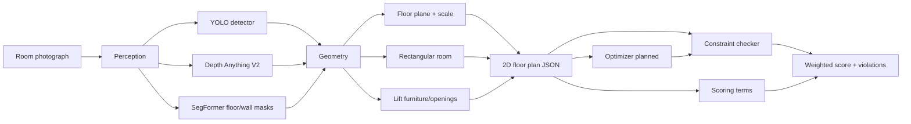

# Midterm Report: 2D Room Layout Representation

## 1. Scope

This checkpoint covers the first half of the project: turning a single room photograph into a
structured 2D floor plan, checking that plan against hard constraints, and scoring it. The
optimizer and final evaluation are planned for the second half.

Implemented at this checkpoint:

- Unified perception: furniture/door/window detection, monocular depth, floor/wall masks.
- Geometry: floor-plane fitting, metric scale calibration, rectangular room estimation,
  furniture footprint lifting, opening placement.
- Representation: JSON floor plan with rooms, furniture, openings, and metric units.
- Scoring: 5 cm occupancy grid, hard constraints, soft terms, and a weighted score.
- Evaluation tooling: unified-class detector mAP, geometry accuracy, and E1/E2 experiment
  harnesses.

## 2. Architecture



Data flow:

1. `PerceptionPipeline` produces detections, a depth map, and floor/wall masks.
2. `GeometryPipeline` fits the floor plane, estimates scale, estimates a rectangular room, and
   projects object footprints onto the floor plane.
3. `FloorPlan` is serialized to JSON.
4. `LayoutScorer` rasterizes furniture, runs hard constraints, computes soft terms, and returns
   a score plus feasibility violations.
5. The optimizer (second half) will search furniture placements using the same scorer.

## 3. Representation and scoring

- Coordinate frame: camera x right, y down, z forward; floor frame `u` right and `v` forward.
- Units: meters after scale calibration.
- Openings: `wall_index` 0=min_y, 1=max_x, 2=max_y, 3=min_x.
- Grid: 5 cm cells, furniture inflated by a clearance margin.
- Hard constraints: inside room, no furniture overlap, doors/windows unobstructed, and
  walkable connectivity.
- Soft terms: overlap, walking area, path quality, wall proximity, door/window clearance,
  utilization, clearance, and pair preferences.
- Score: weighted sum in `[0, 1]`; feasibility is reported separately.

## 4. Experiment design

| ID | Question | Inputs | Metrics |
|---|---|---|---|
| E1 | Does fine-tuning beat zero-shot detection? | COCO/Open Images/Roboflow room images | mAP@0.5, mAP@0.5:0.95, P, R, F1 |
| E2 | Which scale source is accurate enough? | Single photos + depth | room width/depth error, furniture position error, feasibility |
| Geometry | How accurate is the lifted plan? | Own-room photos + hand measurements | room error, furniture center/dim error, footprint IoU |
| E3 | Does optimization improve layouts? | Synthetic + real floor plans | score delta, feasibility rate, runtime (second half) |

Scale modes in E2:

- `metric`: metric depth model; no user dimensions.
- `reference`: known-size object or opening; no user dimensions.
- `user`: user supplies room width/depth.

## 5. Status

| Component | Status |
|---|---|
| Perception pipeline | Implemented, smoke-tested |
| Geometry/floor plan | Implemented, smoke-tested |
| Constraint/scoring module | Implemented, unit-tested |
| Geometry accuracy tooling | Implemented; needs measured room data |
| E1 comparison harness | Implemented; needs full dataset and training run |
| E2 scale harness | Implemented; smoke-tested with relative and metric depth |
| Own-room dataset | Protocol/template ready; photos and measurements pending |
| Optimizer | Not started (second half) |

## 6. Smoke checks

These are pipeline checks, not reportable benchmark results.

Relative-depth perception on `000000000632` (bed + chair):

| Mode | Scale | Room (m) | Camera height (m) | Feasible | Score |
|---|---:|---|---:|---|---:|
| metric | 1.000 | 1.50 x 2.30 | 1.00 | no | 0.886 |
| reference | 1.000 | 1.50 x 2.30 | 1.00 | no | 0.886 |
| user (3.5 x 4.0) | 2.037 | 3.50 x 4.00 | 2.04 | no | 0.909 |

Metric-depth perception on the same image:

| Mode | Scale | Room (m) | Camera height (m) | Feasible | Score |
|---|---:|---|---:|---|---:|
| metric | 1.000 | 1.50 x 1.76 | 1.60 | no | 0.867 |
| reference | 1.000 | 1.50 x 1.76 | 1.60 | no | 0.867 |
| user (3.5 x 4.0) | 2.302 | 3.50 x 4.00 | 3.67 | no | 0.875 |

Relative-depth perception on `000000000139` (table + 3 chairs): score `0.8885`, infeasible due
to chair/table overlaps. `000000000632`: score `0.9085`, infeasible because the bed and chair
fall outside the estimated room.

## 7. Failure cases

- A single photo often shows only part of the floor, so the rectangular room can be too small.
  Both smoke images produced outside-room violations.
- Relative depth is inverse depth; geometry calibrates it against the floor plane, but absolute
  scale still depends on a reference or user dimensions.
- With no door/window detection, the `reference` mode cannot calibrate scale.
- Sparse furniture layouts can make the walking-connectivity constraint fail even when the
  visible area looks reasonable.
- Detection class coverage and small-object recall are the main perception risks.

## 8. Open issues

- Full E1 dataset preparation and fine-tuning are not run yet; the comparison table is pending.
- Own-room photos and hand measurements are needed for geometry accuracy.
- Metric-depth checkpoint is validated for inference, but the room estimate still needs
  measured ground truth.
- Optimizer and E3 experiments are second-half work.

## 9. Next steps

1. Prepare/verify the full detection dataset and run E1 training and comparison.
2. Capture own-room photos and measurements; run `scripts/evaluate_geometry.py`.
3. Build the optimizer (random/greedy then simulated annealing) against `LayoutScorer`.
4. Add E3 synthetic experiments and failure-case visualizations.
5. Finalize the report with measured E1/E2/geometry tables.

## Appendix: commands

```bash
# E1
python scripts/run_e1_detector.py --config configs/detection.yaml \
    --data data/processed --split test \
    --weights yolov8s.pt runs/detect/train/weights/best.pt \
    --labels zero_shot fine_tuned

# E2
python scripts/run_e2_scale.py --perception-dir results/perception/room1 \
    --room-width 3.5 --room-depth 4.0

# Geometry accuracy
python scripts/evaluate_geometry.py \
    --predictions results/geometry \
    --ground-truth data/floorplans_gt
```
